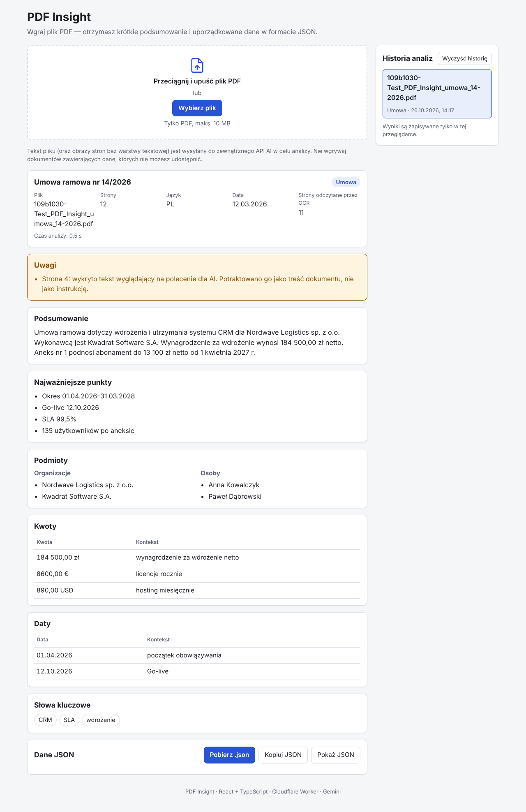

# PDF Insight

Aplikacja webowa, która wczytuje plik PDF, tworzy jego krótkie podsumowanie (3–5 zdań, w języku
dokumentu) i zamienia treść w uporządkowane dane JSON zgodne ze schematem z briefu.

**Demo:** https://gg-qandv.github.io/pdf-insight/
**API:** https://pdf-insight-api.gg-e-067-fammy-pet.workers.dev (Cloudflare Worker, kod w `worker/`)



## Co działa

| ID   | Wymaganie                    | Realizacja                                                                                                                  |
| ---- | ---------------------------- | --------------------------------------------------------------------------------------------------------------------------- |
| F-01 | Wgrywanie PDF (DnD, ≤ 10 MB) | `FileDrop` + `lib/file.ts`: typ/rozszerzenie, sygnatura `%PDF-`, rozmiar; limit również po stronie API                      |
| F-02 | Odczyt tekstu                | `lib/pdf.ts`: pdf.js w przeglądarce, tekst per strona ze znacznikami `[Strona N]`                                           |
| F-03 | Podsumowanie 3–5 zdań        | prompt + walidacja liczby zdań (`shared/sentences.ts`, odporna na skróty „ul.”, „np.”, inicjały)                            |
| F-04 | Dane wg schematu, walidowane | `shared/schema.ts` (Zod) — ta sama walidacja w Workerze **i** w przeglądarce przed wyświetleniem                            |
| F-05 | Widok i eksport              | `ResultView`, podgląd JSON, kopiowanie, pobranie `.json`                                                                    |
| F-06 | Stany interfejsu             | ładowanie (z etapami), błąd z „Spróbuj ponownie”, stan pusty                                                                |
| F-07 | Publiczne demo               | GitHub Pages, deploy przez GitHub Actions                                                                                   |
| F-08 | Długie dokumenty             | `worker/src/chunk.ts`: fragmenty po pełnych stronach (≤ 45 tys. znaków), równoległa analiza, scalanie + synteza             |
| F-09 | Historia analiz              | `lib/history.ts`: ostatnie 10 wyników w `localStorage`, walidowane schematem przy odczycie                                  |
| F-10 | OCR                          | strony bez warstwy tekstowej są renderowane do JPEG i przepisywane przez model multimodalny w osobnym kroku (maks. 5 stron) |

## Architektura

```
Przeglądarka (GitHub Pages)                         Cloudflare Worker (klucze w sekretach)          LLM
1. pdf.js: tekst stron + JPEG skanów ──POST /api/prepare──► OCR skanów (osobne wywołanie) ───────► Gemini → Groq ×3
                                     ◄── tekst + OCR + wykryte fragmenty „poleceń dla AI”
2. [tylko gdy coś wykryto] użytkownik: „wyklucz fragment” albo „zostaw jako dane”
3. ──POST /api/analyze──► ponowna detekcja → wycięcie / oznaczenie <suspicious> → analiza → Zod
                                     → kontrola wyniku (czy nie powtarza treści fragmentu) ───────► Gemini → Groq ×3
   ◄── JSON (walidowany w Workerze i ponownie w SPA)
```

```
src/
  components/   FileDrop, ResultView, JsonPreview, HistoryPanel, StatusViews
  lib/          pdf.ts (pdf.js + OCR-render), file.ts, history.ts, download.ts, format.ts, messages.ts (PL)
  api/          analyze.ts — klient API + walidacja odpowiedzi
shared/         schema.ts (Zod), normalize.ts, sentences.ts — wspólne dla SPA i Workera
worker/src/     index.ts (routing, CORS, limity), prepare.ts (OCR + detekcja), analyze.ts, validated.ts, chunk.ts, merge.ts, prompt.ts, llm.ts, injection.ts
tests/          Vitest: schemat, normalizacja, zdania, chunking, scalanie, prompt injection
```

### Podjęte decyzje

- **Ekstrakcja tekstu w przeglądarce.** Do API trafia tekst (kilkadziesiąt kB), a nie cały plik (do 10 MB) —
  szybciej, taniej i mniej danych wysyłanych na zewnątrz.
- **Backend: Cloudflare Worker.** Darmowy plan, brak „zimnego startu”, wbudowany Rate Limiting; łatwo
  utrzymać demo przez 14+ dni.
- **Model: Gemini 2.5 Flash** (darmowy limit, natywny tryb JSON, obsługa obrazów → OCR bez dodatkowej
  biblioteki).
- **Fallback dostawców:** Gemini → Groq (konta 1, 2, 3). Gdy dostawca zwraca limit (429),
  błąd lub timeout, Worker przekazuje żądanie następnemu; model użyty w analizie jest zapisany w `meta.model`.
- **Jeden schemat, dwie walidacje.** `shared/schema.ts` waliduje odpowiedź modelu w Workerze; SPA waliduje
  ją ponownie przed renderowaniem (brief F-04).
- **Normalizacja przed walidacją.** Drobne potknięcia modelu („184 500,00”, „zł”, „12.03.2026”) są
  poprawiane deterministycznie (`shared/normalize.ts`), zamiast odrzucać wynik.
- **1 ponowna próba.** Jeśli wynik nie przechodzi walidacji, model dostaje listę błędów i jedną szansę na
  poprawkę; potem użytkownik widzi komunikat błędu.
- **Nazwa pliku i liczba stron** pochodzą z klienta, nie z modelu — model nie może ich „zmyślić”.
- **Routing:** aplikacja ma jeden widok, więc nie potrzebuje HashRoutera ani `404.html`.

### Bezpieczeństwo

- Klucz API wyłącznie w sekretach Workera (`wrangler secret put`), nigdy we froncie ani w repozytorium.
- CORS: tylko domena demo i `localhost` (`ALLOWED_ORIGINS`); `POST` z innego originu → 403.
- Limit żądań (20/min/IP — jedna analiza to 2 żądania, Workers Rate Limiting), limit ciała (12 MB), tekstu (400 tys. znaków) i obrazów (5).
- **Prompt injection — 4 warstwy:**
  1. **Detekcja na całym tekście, także ze skanów.** Skany są najpierw przepisywane (OCR) w osobnym
     wywołaniu modelu, dopiero potem heurystyka `injection.ts` (wzorce PL/EN/RU/UK) sprawdza warstwę
     tekstową **i** tekst z OCR — polecenie ukryte w skanie nie omija kontroli.
  2. **Decyzja człowieka.** Gdy coś wykryto, interfejs pokazuje fragment (stronę, źródło, cytat) i pyta:
     _wyklucz fragment_ (zalecane — nie trafia do modelu) albo _zostaw jako dane_ (oznaczony
     `<suspicious>`). Worker wykrywa fragmenty ponownie i nie ufa danym od klienta.
  3. **Prompt:** treść w `<document>…</document>` to dane (próba zamknięcia znacznika jest neutralizowana);
     polecenia z dokumentu, z OCR i z `<suspicious>` nie są wykonywane.
  4. **Kontrola wyniku:** jeśli podsumowanie/punkty powtarzają 5-wyrazowy ciąg występujący tylko we
     wrogim fragmencie, model dostaje jedną poprawkę; potem wynik jest odrzucany (`AI_INJECTED`).

  Wynik trafia do JSON jako `security.promptInjection` (`detected`, `decision`, `findings`, `outputCheck`)
  i jest pokazany w czerwonym panelu nad podsumowaniem. Testowa umowa ma taką instrukcję na stronie 4.

- Bez `dangerouslySetInnerHTML` (wymuszone regułą ESLint); wszystkie wartości renderowane jako tekst.
- Interfejs informuje, że treść pliku trafia do zewnętrznego API AI.

## Uruchomienie lokalne

Wymagania: Node.js 22.

```bash
npm ci
npm ci --prefix worker

# 1) API (Worker) — klucz w worker/.dev.vars (wzór: worker/.dev.vars.example)
cp worker/.dev.vars.example worker/.dev.vars   # wpisz GEMINI_API_KEY
npm run dev --prefix worker                    # http://localhost:8787

# 2) SPA
cp .env.example .env                           # VITE_API_URL=http://localhost:8787
npm run dev                                    # http://localhost:5173/pdf-insight/
```

Kontrole jakości: `npm run lint`, `npm run typecheck`, `npm test`, `npm run build`.

### Zmienne środowiskowe

| Zmienna                                               | Gdzie                     | Opis                                                                     |
| ----------------------------------------------------- | ------------------------- | ------------------------------------------------------------------------ |
| `VITE_API_URL`                                        | SPA (`.env`, Actions var) | adres Workera                                                            |
| `VITE_BASE`                                           | SPA                       | ścieżka GitHub Pages, domyślnie `/pdf-insight/`                          |
| `GEMINI_API_KEY`                                      | Worker — **sekret**       | klucz Google AI Studio                                                   |
| `GEMINI_MODEL`                                        | Worker (`wrangler.toml`)  | domyślnie `gemini-2.5-flash`                                             |
| `GEMINI_THINKING_BUDGET`                              | Worker (`wrangler.toml`)  | tokeny „myślenia” dla kroku analizy (OCR zawsze 0); `0` = wyłączone      |
| `GROQ_API_KEY` / `_2` / `_3`                          | Worker — **sekret**       | fallback: trzy konta Groq, w tej kolejności                              |
| `GROQ_MODEL`                                          | Worker (`wrangler.toml`)  | domyślnie `meta-llama/llama-4-scout-17b-16e-instruct` (obsługuje obrazy) |
| `OPENAI_API_KEY` / `OPENAI_BASE_URL` / `OPENAI_MODEL` | Worker — sekret/vars      | opcjonalnie dowolne API zgodne z OpenAI (np. OpenRouter)                 |
| `ALLOWED_ORIGINS`                                     | Worker (`wrangler.toml`)  | lista originów CORS                                                      |

### Deploy

- **SPA:** push do `main` → workflow `deploy.yml`: lint → typecheck → testy → build → GitHub Pages.
  W ustawieniach repozytorium: _Pages → Source: GitHub Actions_ oraz zmienna `VITE_API_URL`.
- **API:** `npx --prefix worker wrangler deploy --config worker/wrangler.toml` i
  `wrangler secret put GEMINI_API_KEY`; opcjonalnie workflow `worker.yml` (sekrety `CLOUDFLARE_API_TOKEN`,
  `CLOUDFLARE_ACCOUNT_ID`).

## Znane ograniczenia

- OCR obejmuje maks. 5 stron bez warstwy tekstowej na dokument; w pełni zeskanowane, długie PDF-y będą
  przeanalizowane tylko częściowo (komunikat w „Uwagach”).
- Bardzo długie dokumenty: analizowane jest maks. 8 fragmentów (~360 tys. znaków); reszta jest pomijana
  z ostrzeżeniem.
- Kolejność tekstu w układach wielokolumnowych zależy od pdf.js — kolumny mogą się przeplatać.
- Model może przypisać prawdziwą datę lub kwotę z dokumentu do niewłaściwego faktu (przykład z testowej
  umowy: koniec starego abonamentu podany jako 2026-03-31 zamiast 2027-03-31 — data 31.03.2026 istnieje
  w dokumencie, ale dotyczy innego zadania). Walidacja schematu tego nie wykryje. Test z
  `GEMINI_THINKING_BUDGET=1024`: daty poprawne w 3/3 udanych przebiegach, ale 2 z 5 przebiegów nie
  przeszły walidacji nawet po ponownej próbie (~21 s) — w demo „myślenie” jest więc wyłączone (`0`).
  Wyniki warto zweryfikować.
- Licznik zdań jest heurystyczny; nietypowe skróty mogą spowodować ponowną próbę modelu.
- Detekcja prompt injection jest heurystyczna (wzorce PL/EN/RU/UK) — główną ochroną jest konstrukcja promptu.
- Darmowy limit Gemini ogranicza liczbę analiz na minutę; wtedy analizę przejmuje Groq, którego modele
  dają zwykle słabsze podsumowania. Komunikat o błędzie pojawia się dopiero, gdy limity wyczerpią wszyscy dostawcy.
- Rate limiting Workers działa per lokalizacja Cloudflare (nie jest globalnym licznikiem).

## Praca z AI

Zobacz [AI_LOG.md](AI_LOG.md).
